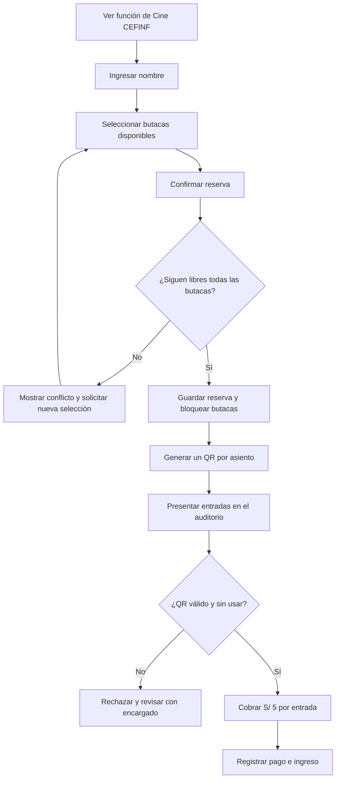
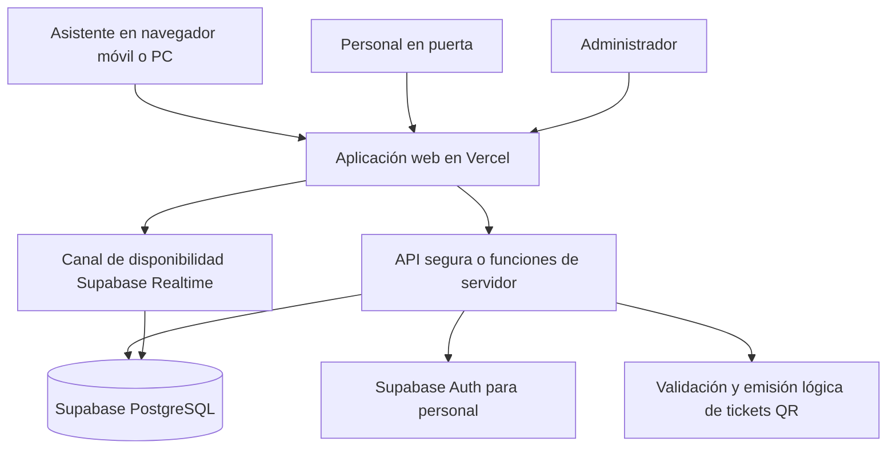
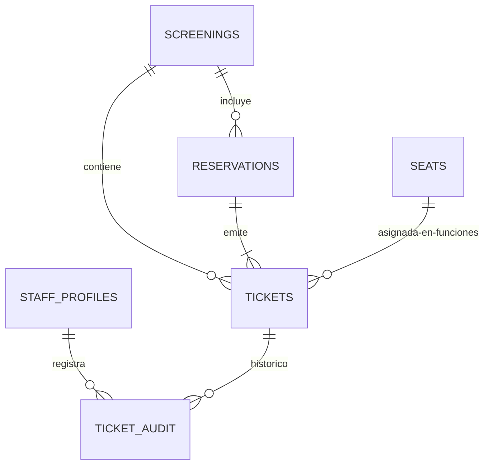

# Cine CEFINF — Documento integral de conversación, requisitos y referencias

> **Proyecto:** Plataforma web de reservas de butacas y entradas QR para las funciones de **Cine CEFINF** (Centro Federado de Informática de la Universidad Nacional de Trujillo).
>
> **Estado del proyecto al cierre de este intercambio:** levantamiento de requisitos e identidad visual; **no** hay aquí una aplicación implementada ni un despliegue realizado.
>
> **Fecha de elaboración del documento:** 16 de octubre de 2026.
>
> **Alcance de esta entrega:** reconstrucción detallada y organizada de todo lo tratado en este chat, decisiones confirmadas, recomendaciones que aún no se han aprobado, dudas pendientes e inventario de los archivos gráficos originales adjuntados.

## Índice

1. [Resumen ejecutivo y decisiones](#1-resumen-ejecutivo-y-decisiones)
2. [Registro cronológico detallado de la conversación](#2-registro-cronológico-detallado-de-la-conversación)
3. [Contexto institucional y evento](#3-contexto-institucional-y-evento)
4. [Objetivos, alcance y exclusiones](#4-objetivos-alcance-y-exclusiones)
5. [Actores y permisos](#5-actores-y-permisos)
6. [Distribución del auditorio: 198 butacas](#6-distribución-del-auditorio-198-butacas)
7. [Flujo completo del estudiante](#7-flujo-completo-del-estudiante)
8. [Boleto digital y códigos QR](#8-boleto-digital-y-códigos-qr)
9. [Pago presencial e ingreso](#9-pago-presencial-e-ingreso)
10. [Disponibilidad, simultaneidad y cancelaciones](#10-disponibilidad-simultaneidad-y-cancelaciones)
11. [Panel de administración](#11-panel-de-administración)
12. [Identidad visual e interfaces](#12-identidad-visual-e-interfaces)
13. [Tecnología: Vercel y Supabase](#13-tecnología-vercel-y-supabase)
14. [Propuesta de arquitectura y modelo de datos](#14-propuesta-de-arquitectura-y-modelo-de-datos)
15. [Reglas funcionales y requisitos de calidad](#15-reglas-funcionales-y-requisitos-de-calidad)
16. [Pantallas y rutas propuestas](#16-pantallas-y-rutas-propuestas)
17. [Casos de uso y criterios de aceptación](#17-casos-de-uso-y-criterios-de-aceptación)
18. [Plan de construcción y pruebas](#18-plan-de-construcción-y-pruebas)
19. [Decisiones pendientes y discrepancias](#19-decisiones-pendientes-y-discrepancias)
20. [Inventario de archivos adjuntos](#20-inventario-de-archivos-adjuntos)
21. [Recursos web mencionados](#21-recursos-web-mencionados)
22. [Estado final y transferencia a desarrollo](#22-estado-final-y-transferencia-a-desarrollo)

---

## 1. Resumen ejecutivo y decisiones

### 1.1. Qué se quiere construir

**Cine CEFINF** será una **plataforma web** para que estudiantes o asistentes puedan reservar butacas numeradas para una proyección organizada en el auditorio universitario. El usuario introduce su **nombre**, ve un **plano interactivo de 198 butacas**, elige una o varias y confirma. Después recibe **una entrada con código QR por cada asiento confirmado**. Una butaca reservada deja de estar disponible para los demás. En el acceso al auditorio, personal organizador escanea el QR, cobra la entrada **presencialmente** y registra el ingreso.

Se ha elegido una arquitectura de despliegue basada en **Vercel + Supabase**. El sistema utiliza la identidad visual institucional de CEFINF y una estética cinematográfica coherente con los afiches y boletos aportados.

### 1.2. Matriz de decisiones, con su grado de confirmación

| Tema | Definición | Estado |
|---|---|---|
| Finalidad | Reservar butacas y emitir QR para cine universitario | **Confirmado por el usuario** |
| Capacidad | 198 butacas | **Confirmado** |
| Plano | Dos bloques de 9 asientos × 11 filas, con separación central | **Confirmado en lo esencial**; falta numeración física exacta |
| Identificación | Registro sencillo por nombre | **Confirmado** |
| Elección | Selección visual de una o varias butacas disponibles | **Confirmado** |
| Disponibilidad | Las butacas confirmadas quedan bloqueadas para terceros | **Confirmado** |
| Entradas | Un QR distinto por cada butaca reservada | **Confirmado** |
| Precio | S/ 5 por entrada | **Confirmado** |
| Momento del cobro | **Al ingresar al auditorio** | **Confirmado expresamente** |
| Pago electrónico | No forma parte de la web | **Confirmado expresamente** |
| Verificación | Escaneo de QR en puerta y prevención de doble uso | **Aceptado durante la definición del flujo** |
| Plataforma de despliegue | Vercel | **Confirmado** |
| Datos y reservas | Supabase | **Confirmado** |
| Identidad visual | Materiales institucionales CEFINF + estética de cine | **Confirmado como referencias** |
| Frontend | Next.js es la propuesta técnica más reciente | **Propuesto, no aprobado de forma expresa** |
| Máximo por operación | Ejemplo de hasta 4 butacas por reserva | **Propuesto, pendiente de decisión** |
| Reserva temporal al seleccionar | Opcional; no necesaria para la versión mínima | **Propuesta técnica** |
| Método de recuperación del boleto | Enlace privado/descarga/correo opcional | **Pendiente** |
| Cancelación por el usuario | Por determinar | **Pendiente** |

**Regla central acordada:** una **reserva confirmada** bloquea la butaca **antes de que el estudiante pague**. El QR emitido es la constancia de esa reserva, **no un comprobante de pago**.

---

## 2. Registro cronológico detallado de la conversación

Esta sección recoge las intervenciones y respuestas **en orden de aparición**, conservando el sentido y los detalles. **Es una documentación elaborada a partir del intercambio, no una transcripción literal de todas las frases ni un registro de implementaciones realizadas.**

### Etapa 1 — Investigación de una plataforma de cine universitario

**Solicitud original del usuario:** investigar plataformas de cine (mencionó Cineplanet como ejemplo) y entender cómo implementar una solución sencilla para registrar reservas en un auditorio de **198 butacas**, dispuestas en **dos columnas o bloques de 9 × 11**, con la pantalla al frente. El visitante debe introducir su **nombre**, escoger asientos y recibir **un QR individual por asiento**. Cualquier butaca tomada debe dejar de poder elegirse por otro visitante.

**Respuesta y conclusiones que se discutieron:**

- Se comparó el flujo comercial de cines como **Cineplanet** y **Cinemark**: selección de película/función, mapa de asientos, introducción de datos y emisión de entradas digitales.
- Se decidió conservar la **mecánica de reserva** y prescindir de funciones de venta comercial, cuentas complejas, promociones, carrito de confitería y pagos integrados.
- Se propuso una secuencia simplificada: **Nombre → Butacas → Confirmación → QR por butaca → Control de acceso**.
- Para representar el auditorio se propusieron **11 filas de A a K**, **18 asientos por fila** y un **pasillo central** separando dos grupos de nueve.
- Se enfatizó el problema de concurrencia: no basta con pintar una butaca como ocupada en la interfaz; la **base de datos** debe impedir reservas simultáneas del mismo asiento.
- Se mencionó como posible mejora retener asientos temporalmente durante una reserva, pero no imponer ese mecanismo al MVP.

**Alternativas externas consideradas:**

1. **pretix**: plataforma de eventos con entradas, gestión de asistentes y capacidades de asientos; se señaló que ciertas modalidades/complementos pueden tener requisitos comerciales, por lo que no se confirmó su encaje definitivo.
2. **Seats.io**: componente/API para mapas y bloqueos de asientos que requiere programar el resto del sistema.
3. **Ticket Tailor**: servicio de tickets con funciones de asientos, sujeto a sus condiciones y tarifas.
4. **Desarrollo propio**: alternativa adecuada por tratarse de un solo cine universitario, un flujo pequeño y necesidad de una interfaz muy personalizada.

**Recomendación de esa etapa:** evaluar una plataforma lista para usar si la fecha exigía urgencia, pero priorizar **una web propia** si se buscaba control sobre diseño, butacas y reutilización futura.

### Etapa 2 — Materiales visuales aportados por el usuario

El usuario envió **nueve archivos** que comprenden el afiche de la función, un archivo PSD del ticket, una previsualización de ese ticket, publicaciones institucionales de Informática/CEFINF y tres variantes del logotipo institucional. Indicó que estos elementos constituían la **identidad visual que se debía respetar** y que el sistema se desplegaría usando **Vercel y Supabase**.

**Hallazgos visuales comunicados:**

- Una línea **cinematográfica**: fondos oscuros, plateado, contrastes altos, símbolos/recortes de boleto, tipografía fuerte e imágenes asociadas a Avengers: Endgame.
- Una línea **institucional**: azul intenso de Informática/UNT, blanco, detalles grises, dorados y composiciones de publicaciones del centro federado.
- Para la interfaz se propuso **combinar ambas**, predominando la atmósfera de cine y conservando la marca CEFINF.
- Se estableció como propuesta de color la paleta: `#07111F`, `#0C4DC5`, `#D7DEE7`, `#E5C477`, `#F8FAFC`.
- Se propuso un ticket digital con datos de función, asiento, precio y QR, inspirado en el ticket vertical entregado.
- Se aclaró que las ilustraciones y bloques mostrados en el chat eran **referencias conceptuales**, no pantallas o tickets operativos.

**Datos del evento extraídos de los afiches:** *Avengers: Endgame*, **23 de octubre de 2026**, **4:30 p. m.**, **Auditorio de Ciencias Sociales**, **S/ 5**. Se detectó una discrepancia en un boleto que decía «jueves 23 de octubre», mientras que el afiche decía «viernes 23»: el **23/10/2026 cae viernes**. También hubo divergencia entre «escenas poscréditos Doomsday» y «tráiler de Avengers: Doomsday».

### Etapa 3 — Primera arquitectura técnica propuesta

Al confirmarse **Vercel + Supabase**, la respuesta propuso:

- **Next.js** como frontend y base para la aplicación web en Vercel.
- **Supabase PostgreSQL** como fuente de datos y mecanismo de integridad.
- **Supabase Auth** para los administradores, sin necesidad de cuentas estudiantiles en la experiencia inicial.
- **Supabase Realtime** para reflejar cambios de disponibilidad en los clientes conectados.
- **Funciones de servidor o RPC segura** para registrar reservas sin carreras.
- Generación de QR únicos y uso del teléfono del organizador para el control de acceso.
- Tres áreas funcionales de primera versión: **reserva pública, mis entradas y administración/verificación**.

**Advertencia:** no se ha creado todavía una base de datos, proyecto de Supabase, repositorio, aplicación Next.js ni despliegue. Aquí se trata de una propuesta de arquitectura.

### Etapa 4 — Definición expresa de pago

El usuario respondió:

> «El pago será de S/ 5 al ingresar al auditorio. La plataforma solo gestiona reservas y QR, sin cobrar online.»

**Consecuencias confirmadas:**

- La web **no cobra** los S/ 5; no se necesita integrar pasarela, Yape, Plin ni tarjeta.
- El asiento se **reserva y bloquea** al confirmarlo en la web, aunque aún no se haya pagado.
- Los tickets QR se **emiten antes del pago**.
- En la puerta, el personal **lee el QR, cobra S/ 5 por cada entrada y registra su uso**.
- El QR sirve para validar la existencia y vigencia de la reserva; no equivale a un recibo de dinero.
- Se discutieron estados visuales **Disponible / Reservada / Pagada / Ingresó**, con la salvedad técnica de que **pago e ingreso deberían registrarse como datos separados** para no perder precisión.

### Etapa 5 — Límite de butacas por usuario

Se planteó **hasta 4 butacas por reserva** como sugerencia para prevenir abuso y reventa/acaparamiento. **El usuario no ha confirmado ese límite**. Tampoco se ha definido si debe existir un máximo de reservas por nombre, una identidad institucional, un correo de contacto o un mecanismo de recuperación.

### Etapa 6 — Solicitud de la presente entrega

El usuario pidió un **archivo Markdown muy detallado de toda esta conversación** y un **ZIP con los archivos adjuntos utilizados**. La presente entrega contiene:

- Un `.md` autónomo para lectura rápida o uso como especificación inicial.
- Un `.zip` que incluye **el mismo Markdown, los nueve adjuntos originales y un manifiesto de comprobación**.
- Los archivos originales se incorporan **sin rediseños, conversiones ni cambios**; en especial se conserva el **PSD**.

---

## 3. Contexto institucional y evento

### 3.1. Organizador

**CEFINF:** Centro Federado de Informática de la Universidad Nacional de Trujillo, Perú. El proyecto de reserva se presenta bajo la identidad **Cine CEFINF**.

### 3.2. Función de referencia

| Campo | Valor |
|---|---|
| Nombre de la función | Cine CEFINF — *Avengers: Endgame* |
| Película principal | *Avengers: Endgame* |
| Fecha | **Viernes 23 de octubre de 2026** |
| Hora mostrada en el afiche | **4:30 p. m.** |
| Lugar | **Auditorio de Ciencias Sociales** |
| Universidad | Universidad Nacional de Trujillo |
| Precio | **S/ 5 por entrada** |
| Forma de pago | **En persona al ingresar al auditorio** |
| Capacidad | **198 butacas numeradas** |
| Contenido adicional anunciado | Referencias gráficas a *Doomsday*, con texto por unificar |
| Apertura de puertas / horario límite | **No especificados** |

La plataforma debe poder reutilizarse para **funciones futuras**, aunque inicialmente se prioriza esta proyección. Si se modelan varias funciones, la disponibilidad de un mismo asiento es **por función**, no global y permanente.

### 3.3. Observaciones editoriales de la gráfica

- El afiche principal muestra **«VIERNES 23 OCTUBRE»**; eso es correcto para el año 2026.
- El ticket PSD y su PNG de previsualización muestran **«JUEVES, 23 DE OCTUBRE»**: debe corregirse antes de usarlo como boleto definitivo.
- El afiche principal menciona **«+ escenas poscréditos Doomsday»** y el diseño del ticket **«+ tráiler de Avengers: Doomsday»**. Debe escogerse una sola redacción veraz; **no implica que la película Doomsday vaya a proyectarse**.
- El afiche hace referencia a **venta de canchita en la entrada**, pero la plataforma web **no necesita vender alimentos**.
- La gráfica del ticket contiene una franja clara vacía que puede destinarse al código QR, número de asiento y datos variables, conservando el diseño original.

---

## 4. Objetivos, alcance y exclusiones

### 4.1. Objetivo general

Permitir que una persona reserve, desde un teléfono o computadora, butacas reales y numeradas de una función de Cine CEFINF, reciba una entrada QR verificable para cada asiento y se presente al auditorio a realizar el pago presencial de S/ 5 e ingresar.

### 4.2. Objetivos específicos

1. Mostrar información clara de la función (obra, fecha, hora, auditorio, precio y modalidad de pago).
2. Registrar un **nombre** asociado a la reserva.
3. Representar la geometría real de **198 asientos**, con orientación respecto de la pantalla.
4. Señalar visualmente butacas disponibles, seleccionadas, reservadas y, en el panel, ya utilizadas.
5. Permitir seleccionar varias butacas en una misma operación, sujeto al límite que se defina.
6. Impedir de forma transaccional que una butaca tenga dos reservas activas en una misma función.
7. Emitir **una entrada única por asiento**.
8. Permitir conservar/descargar las entradas y mostrarlas en puerta.
9. Validar cada QR en línea, sin reutilizaciones.
10. Registrar el pago presencial y el ingreso mediante personal autorizado.
11. Permitir a organizadores consultar disponibilidad, reservas, tickets e ingresos.
12. Mantener una web consistente con la identidad **CEFINF/UNT**.

### 4.3. Exclusiones confirmadas

- **Sin cobro online** y sin pasarela bancaria.
- **Sin carrito de confitería** ni venta web de comida.
- Sin necesidad de desarrollar aplicaciones nativas Android/iOS en la primera versión.
- Sin necesidad de imitar las características extensas de un cine comercial.
- El nombre del usuario **no equivale a validación de identidad**.

### 4.4. Fuera de alcance propuesto para el MVP

Funciones avanzadas como envío masivo de correos, reservas por DNI/código universitario, mapa 3D, lista de espera, pagos conciliados, sorteos, múltiples roles sofisticados, sistema de fidelización, estadística histórica avanzada o integración institucional SSO. Podrían agregarse después, pero no se han pedido como requisitos.

---

## 5. Actores y permisos

| Actor | Lo que hace | Autenticación esperada |
|---|---|---|
| **Asistente/estudiante** | Se identifica por nombre, consulta disponibilidad, selecciona butacas, confirma y obtiene QR | Sin cuenta en primera versión |
| **Personal de puerta** | Escanea QR, ve estado, recibe S/ 5 presencialmente, marca pago e ingreso | Acceso autenticado y autorizado |
| **Administrador/organizador** | Configura función, supervisa butacas, busca reservas, libera/cancela, consulta asistentes, administra acceso | Acceso autenticado con privilegios |

La disponibilidad pública **no debe revelar los nombres de quienes reservaron otras butacas**. Aunque todos pueden ver que un asiento está ocupado, los datos personales se muestran solo al interesado mediante un enlace privado y a responsables autorizados.

---

## 6. Distribución del auditorio: 198 butacas

### 6.1. Interpretación de la disposición descrita

- Dos bloques, **izquierdo y derecho**.
- Cada bloque tiene **9 butacas por fila** y **11 filas**.
- Total por bloque: `9 × 11 = 99`.
- Total de los dos bloques: `99 × 2 = 198`.
- La pantalla está delante de la **fila A**.
- La **fila K** queda al fondo.
- Entre bloques hay un **pasillo central**, representado como separación sin butacas.

### 6.2. Convención de numeración propuesta

Una numeración simple para el sistema: **A01–A18** para la fila A; **B01–B18** para la B; y así hasta **K01–K18**. En cada fila:

- **01–09**: bloque izquierdo.
- **10–18**: bloque derecho.
- **A01** corresponde a una butaca delantera; **K18** a una trasera.
- La convención final debe coincidir con las **etiquetas físicas instaladas en el auditorio**; si los asientos están numerados por bloque o desde otro extremo, prevalecerá esa numeración real.

### 6.3. Plano textual conceptual

```text
                         PANTALLA DE PROYECCIÓN
              ══════════════════════════════════════

                   BLOQUE IZQ.      BLOQUE DER.
                   (9 butacas)       (9 butacas)
                     PASILLO CENTRAL ENTRE AMBOS

A (delante)   A01 A02 A03 A04 A05 A06 A07 A08 A09   ║   A10 A11 A12 A13 A14 A15 A16 A17 A18
B             B01 B02 B03 B04 B05 B06 B07 B08 B09   ║   B10 B11 B12 B13 B14 B15 B16 B17 B18
C             C01 C02 C03 C04 C05 C06 C07 C08 C09   ║   C10 C11 C12 C13 C14 C15 C16 C17 C18
D             D01 D02 D03 D04 D05 D06 D07 D08 D09   ║   D10 D11 D12 D13 D14 D15 D16 D17 D18
E             E01 E02 E03 E04 E05 E06 E07 E08 E09   ║   E10 E11 E12 E13 E14 E15 E16 E17 E18
F             F01 F02 F03 F04 F05 F06 F07 F08 F09   ║   F10 F11 F12 F13 F14 F15 F16 F17 F18
G             G01 G02 G03 G04 G05 G06 G07 G08 G09   ║   G10 G11 G12 G13 G14 G15 G16 G17 G18
H             H01 H02 H03 H04 H05 H06 H07 H08 H09   ║   H10 H11 H12 H13 H14 H15 H16 H17 H18
I             I01 I02 I03 I04 I05 I06 I07 I08 I09   ║   I10 I11 I12 I13 I14 I15 I16 I17 I18
J             J01 J02 J03 J04 J05 J06 J07 J08 J09   ║   J10 J11 J12 J13 J14 J15 J16 J17 J18
K (fondo)    K01 K02 K03 K04 K05 K06 K07 K08 K09   ║   K10 K11 K12 K13 K14 K15 K16 K17 K18
```

El símbolo `║` representa el **pasillo**, no un asiento. La representación web deberá conservar visualmente el espacio del pasillo, rotular las filas y mostrar la pantalla al frente. En teléfonos, puede usar escalado o desplazamiento horizontal controlado para que los botones sigan siendo fáciles de tocar.

### 6.4. Leyenda de estados

| Estado visual | Público puede elegir | Qué significa |
|---|---|---|
| Disponible (p. ej., verde/neutral) | Sí | No existe reserva activa para esa butaca en esta función |
| Seleccionada (p. ej., azul) | Sí, solo durante la selección local | El usuario la eligió, todavía no es reserva definitiva |
| Reservada (p. ej., gris/rojo tenue) | No | Existe una reserva activa de otra persona o de la propia |
| Bloqueada temporalmente (si se implementa) | No mientras dure el bloqueo | Otra operación la mantiene en proceso |
| Pagada / ingresó | No | Información administrativa adicional sobre una butaca reservada |

No confiar únicamente en el color: cada estado debe tener **texto accesible**, etiquetas e indicación de selección.

---

## 7. Flujo completo del estudiante

### 7.1. Entrada a la plataforma

- Llega mediante enlace compartido o QR promocional (método de difusión aún por definir).
- Ve la marca CEFINF, un héroe/banner de *Avengers: Endgame*, fecha, hora, lugar, precio y botón **Reservar butacas**.
- Ve claramente: **«Reserva aquí. Paga S/ 5 al ingresar al auditorio»**.

### 7.2. Identificación

- Introduce al menos su **nombre completo**.
- No está obligado a registrarse con usuario y contraseña.
- La interfaz valida que el nombre no esté en blanco y evita entradas evidentemente inválidas.
- En la versión original propuesta, el correo o número de contacto es **opcional/por definir**; no se debe afirmar que sea obligatorio.

### 7.3. Selección de butacas

- Visualiza las **198** butacas con dos bloques y pantalla adelante.
- Toca asientos libres. Cada uno queda resaltado como **seleccionado**.
- Puede deseleccionar antes de confirmar.
- Ve el listado: por ejemplo, `C05, C06, D11` y la cantidad total.
- Si se acuerda un límite por reserva, la interfaz evita superar ese límite y el servidor lo verifica de nuevo.
- Un contador de «disponibles» puede actualizarse automáticamente.

### 7.4. Confirmación

- Lee un resumen: nombre, película, función, butacas, cantidad y total **a pagar en puerta** (`n × S/ 5`), **sin pedir datos de tarjeta**.
- Presiona **Confirmar reserva**.
- El servidor verifica en una transacción que todos los asientos siguen libres.
- Si todos están libres, se crean **una reserva y n tickets individuales**, y se bloquean las butacas.
- Si alguno fue tomado mientras elegía, se rechaza la operación de forma clara: no se debe confirmar parcialmente sin informarlo; lo más sencillo es **pedir una nueva selección**.

### 7.5. Recepción de entradas

- Se muestra una pantalla de éxito con nombre, función y **una tarjeta/QR por butaca**.
- El usuario puede conservarlos mediante descarga individual, imagen o PDF (la forma exacta de descarga todavía es una decisión de diseño).
- Un mismo responsable puede reservar, por ejemplo, **tres butacas** y recibir **tres QR diferentes**.
- Cada QR puede mostrarse de manera independiente para facilitar el ingreso de acompañantes.
- Se necesita una estrategia para recuperar entradas si se cierra la página; esto sigue pendiente de aprobación.

### 7.6. Día de la función

- Lleva los QR, en teléfono o impresos.
- El personal escanea cada QR, verifica que corresponde a esa función y butaca y que no se ha utilizado.
- Se realiza **cobro presencial de S/ 5 por entrada**.
- El encargado registra el pago y el ingreso.
- Tras la validación, un QR **ya utilizado** no debe abrir una nueva admisión.

### 7.7. Diagrama del flujo



---

## 8. Boleto digital y códigos QR

### 8.1. Información del ticket

Datos visibles propuestos:

| Campo | Ejemplo o significado |
|---|---|
| Marca | CINE CEFINF / logotipo CEFINF |
| Función | AVENGERS: ENDGAME |
| Fecha | Viernes 23/10/2026 |
| Hora | 4:30 p. m. |
| Lugar | Auditorio de Ciencias Sociales |
| Titular de la reserva | Nombre de la persona que registró la reserva |
| Butaca | F08 (una butaca por ticket) |
| Precio | S/ 5 |
| Modalidad | «Paga al ingresar» |
| QR | Código único que representa una entrada verificable |
| Estado | Reservada / utilizada (la versión pública no debe ofrecer editarlo) |

El ejemplo visual «F-08» mostrado durante el chat era **ficticio**, solo para explicar la composición, **no** una reserva real.

### 8.2. QR individual y validez

- **1 butaca = 1 ticket = 1 QR único**.
- El QR puede guardar un **token aleatorio opaco** o una URL con ese token; no debe contener una instrucción que admita acceso solo por mostrar cualquier cadena inventada.
- El servidor debe **consultar el ticket** y comprobar: existencia, función correcta, no cancelado, no usado y condiciones de ingreso.
- Un QR reproducido o presentado por segunda vez debe marcarse como **ya utilizado**.
- Es preferible que la operación de «marcar ingresado» sea **atómica** y asociada a la identidad del personal que la realizó.
- No es necesario codificar el nombre en texto claro dentro del QR; se puede mantener el dato en la base y mostrarlo solo al personal autorizado.

### 8.3. Diseño del boleto

Tomar como referencia el **boleto vertical PSD/PNG** proporcionado. Conservar su identidad visual general, reservando área legible para QR y datos dinámicos. El ticket final **no debe mostrar «Jueves 23»** para esta función ni quedar con el rectángulo blanco sin información. El código QR de una publicación para redes sociales **no es un boleto de ingreso**.

### 8.4. Descarga y transferencia

Se mencionó descarga de entradas en formato **imagen o PDF**; ninguna variante se ha elegido como obligatoria. En ambos casos la validación sigue siendo **online contra Supabase**. El archivo no debe ser capaz de autovalidarse sin pasar por el servidor.

---

## 9. Pago presencial e ingreso

### 9.1. Decisión definitiva

> **Cobrar S/ 5 por entrada al ingresar al auditorio. Ningún pago online.**

Esta decisión afecta el flujo y el diseño de datos:

1. **Reservar** no significa **pagar**.
2. El usuario **sí recibe QR antes de pagar**.
3. El bloqueo de asiento **sí ocurre antes de pagar**.
4. El cobro se efectúa por el organizador **en la entrada**.
5. El personal usa el sistema para evitar que un QR se **acepte dos veces**.
6. No debe rotularse una entrada como «PAGADA» si solamente está reservada.

### 9.2. Estados de pago e ingreso (mejor precisión)

Aunque en el chat se mostraron cuatro etiquetas simples (**Disponible, Reservada, Pagada, Ingresó**), para implementarlo conviene representar **dos dimensiones**:

| Dimensión | Valores sugeridos | Descripción |
|---|---|---|
| Reserva/ticket | `reservado`, `cancelado`, `ingresado` | Si ocupa la butaca y si el QR ya fue consumido |
| Pago | `pendiente`, `pagado` | Si se registró el cobro de S/ 5 |

Ejemplos:

- **Reservado + pendiente:** tiene QR, aún no ha pagado.
- **Reservado + pagado:** se recibió dinero, todavía falta registrar entrada si el equipo lo maneja en dos pasos.
- **Ingresado + pagado:** ingreso correctamente autorizado.
- **Cancelado:** ticket no utilizable; según las reglas, la butaca se libera.

**Recomendación operativa:** en la pantalla de puerta, permitir **«Confirmar pago e ingreso»** solo después de recibir el dinero. En caso de separar ambas acciones, manejarlo explícitamente para que no aparezcan entradas admitidas sin pago por un error de flujo.

### 9.3. Cálculo ilustrativo

- **1 entrada:** S/ 5 al ingresar.
- **2 entradas:** S/ 10 al ingresar.
- **4 entradas:** S/ 20 al ingresar.
- **Aforo completo de 198 entradas pagadas:** `198 × S/ 5 = S/ 990` **como máximo teórico de recaudación**, no como una recaudación real ni pronóstico.

---

## 10. Disponibilidad, simultaneidad y cancelaciones

### 10.1. Riesgo principal: dos personas eligen lo mismo

Caso discutido: **Ana** y **Luis** ven la butaca `D08` libre casi simultáneamente. Ana confirma primero. Cuando Luis confirma, la transacción detecta que esa butaca ya tiene un ticket activo y **rechaza** el intento de Luis.

**Regla obligatoria:** la verdad sobre ocupación está en **PostgreSQL**, no en el estado visual del navegador. La actualización en tiempo real ayuda a mostrar cambios, **pero no garantiza exclusión** por sí sola.

### 10.2. Estrategia mínima propuesta

- Confirmación de todas las butacas en **una sola transacción**.
- Validación de función, asientos, límite de entradas y campos requeridos.
- Restricción de unicidad en base de datos para el par **función + butaca activa**.
- Ante una colisión, notificar y solicitar nueva selección.
- Sin tiempos de espera complejos: una vez confirmada, la reserva queda **definitiva** hasta una eventual cancelación.

### 10.3. Bloqueo temporal opcional

Se explicó que servicios como Seats.io ofrecen **holds** temporales durante el proceso de selección. Para este evento sin pago web, se recomendó **no incluirlo en la primera versión salvo necesidad**. Si se incorpora después, deberá definirse duración, expiración en servidor y tratamiento de usuarios desconectados.

### 10.4. Cancelaciones

La administración **podría** disponer de cancelar/liberar butacas. Sin embargo, **no quedó acordado** si el estudiante podrá cancelar su propia reserva, durante qué plazo ni si se abrirá una lista de espera. Esta función debe especificarse antes de entrar a producción.

---

## 11. Panel de administración

Se propuso un **panel privado separado** de la web del asistente.

### 11.1. Operaciones principales

- Iniciar sesión como organizador.
- Ver el resumen de la función y **198 plazas**.
- Contar **reservadas**, **disponibles**, **pagadas** e **ingresadas**; no confundir los conteos.
- Ver mapa de asientos con estados actualizados.
- Consultar reservas por **nombre**, butaca o código.
- Abrir detalle de una reserva, incluidos todos sus tickets.
- Escanear QR desde la cámara del celular.
- Rechazar QR inválidos, cancelados, de otra función o ya utilizados.
- Registrar **pago de S/ 5 por entrada** y **asistencia**.
- Cancelar y liberar butacas con permisos adecuados.
- Exportar, si se requiere, lista de asistentes (se mencionó como posibilidad, no obligación cerrada).

### 11.2. Ejemplo mostrado en el chat

Se utilizó un **panel ilustrativo** con cifras **ficticias**: 198 de capacidad, 136 reservadas y 62 disponibles; ejemplos de Ana Torres, Luis Pérez y María López. **No representan datos reales del evento** ni usuarios registrados.

### 11.3. Seguridad administrativa

- Las operaciones de pago/ingreso/cancelación deben requerir **personal autenticado**.
- Una persona que escanea un QR con una aplicación QR genérica **no debe poder marcarlo usado** si no tiene permisos.
- Para evitar fraude o equivocaciones, guardar **qué encargado realizó la validación y cuándo**.
- Nunca exponer la **service-role key** de Supabase en JavaScript del navegador o en el repositorio.

---

## 12. Identidad visual e interfaces

### 12.1. Dos lenguajes gráficos observados

**A. Cine / Avengers / CEFINF**

- Fondos muy oscuros y negros.
- Contrastes brillantes o metálicos, plateados.
- Azul noche y leves reflejos azulados.
- Formas de ticket con borde ornamental y marcas de corte.
- Titulares grandes, impactantes, tipografía condensada/cinematográfica.
- Uso de imágenes de Avengers como referencia al **evento**, no como sustituto del logo institucional.

**B. Ingeniería Informática / CEFINF institucional**

- Azul institucional intenso.
- Blancos de alto contraste y gris claro.
- Detalles dorados, asociados al logotipo/escudo.
- Motivos tecnológicos lineales (CPU, cable, discos, conectores).
- Composiciones más juveniles: collage, papeles, elementos gráficos y titulares expresivos.

**Decisión de diseño propuesta:** identidad **principalmente cinematográfica**, preservando reconocimiento visual de CEFINF/Informática UNT. No construir una web íntegramente azul saturado ni una web comercial ajena a la institución.

### 12.2. Paleta web inicial propuesta — NO declarada paleta oficial

| Rol | Hex | Uso sugerido |
|---|---|---|
| Azul noche | `#07111F` | Fondo principal / bloques oscuros |
| Azul UNT / acento | `#0C4DC5` | Botones principales, selección, enlaces |
| Plateado | `#D7DEE7` | Elementos secundarios y texto de soporte |
| Dorado | `#E5C477` | Precio, detalles especiales, acentos discretos |
| Blanco | `#F8FAFC` | Texto contrastante y superficies claras |

Los colores se propusieron como **tokens iniciales de diseño**, no como alteración de los logos. En una futura implementación deben verificarse contraste, accesibilidad y consistencia con los gráficos reales.

### 12.3. Componentes visuales recomendados

1. **Barra superior:** isotipo/sigla CEFINF, nombre «Cine CEFINF», vínculo a la función.
2. **Portada cinematográfica:** pieza de Avengers: Endgame, fecha, sede, hora, precio; CTA **Reservar butacas**.
3. **Formulario de nombre:** pequeño, claro y apto para móvil.
4. **Plano:** pantalla frontal claramente marcada, filas A–K, bloques 9+9, pasillo, leyenda.
5. **Resumen:** cantidad de butacas, identificadores, total por pagar presencialmente.
6. **Entradas digitales:** verticales, un QR por ticket, opción para conservarlas.
7. **Panel de puerta:** lectura QR ágil, estado legible, confirmación de pago e ingreso.
8. **Administrador:** resumen de funciones, reservas, ocupación, consulta/cancelación.

### 12.4. Tipografía y composición

Las referencias incluyen tipografías llamativas en afiches y piezas sociales. La interfaz operativa, sin embargo, debe ser **legible**, especialmente en botones de butacas, mensajes de error, numeración, fecha, precio y ticket. Puede reservarse una fuente expresiva para titulares mientras el texto de interfaz usa una sans-serif de alta legibilidad. **No se decidió una familia tipográfica obligatoria.**

### 12.5. Diseño responsivo

- Prioridad: teléfonos del alumnado, seguidos de desktop para organización.
- El plano puede tener un contenedor desplazable horizontalmente o escalable: **no reducir los asientos hasta volverlos intocables**.
- Las butacas elegidas y el total deben permanecer visibles o ser fáciles de consultar.
- Confirmaciones y errores deben distinguirse sin depender solo del color.
- El ticket debe leerse sin zoom y el QR debe dejar suficiente área blanca y margen para escanearse.

---

## 13. Tecnología: Vercel y Supabase

### 13.1. Decisiones confirmadas

- **Vercel:** alojamiento y despliegue de la aplicación web.
- **Supabase:** backend de datos y estado de reservas.

### 13.2. Stack recomendado en la conversación (por confirmar a nivel implementación)

| Capa | Elección discutida | Función |
|---|---|---|
| Interfaz | **Next.js** (React) | Páginas, formularios, mapa, boletos, administración |
| Hosting | **Vercel** | Publicación HTTPS, despliegues desde repositorio |
| Persistencia | **Supabase PostgreSQL** | Funciones, butacas, reservas, tickets, estados |
| Auth de encargados | **Supabase Auth** | Sesiones y roles autorizados |
| Actualizaciones UI | **Supabase Realtime** | Refrescar mapa y contadores |
| Operaciones sensibles | **API de servidor / funciones seguras / PostgreSQL RPC** | Confirmación atómica, pago, ingreso, cancelación |
| Generación de QR | Librería compatible con frontend/backend | Renderizar identificador seguro de ticket |
| Escaneo | Cámara del móvil en área privada | Validar QR con backend |

En una respuesta temprana también se mencionó **HTML, CSS y JavaScript** como alternativa sencilla; posteriormente se recomendó **Next.js** al fijarse Vercel/Supabase. El usuario **no ha elegido formalmente entre esas implementaciones**, aunque Next.js es la dirección técnica actual.

### 13.3. Arquitectura conceptual



**Importante:** solo Vercel y Supabase están confirmados como servicios; el resto es propuesta de implementación. El QR puede renderizarse en frontend, pero su **autenticidad se valida en backend**.

---

## 14. Propuesta de arquitectura y modelo de datos

> **Esta sección es una especificación técnica sugerida para iniciar el desarrollo. No corresponde a tablas ni migraciones que ya existan.** Se incluye porque ayuda a transferir los requisitos de la conversación a un proyecto real sin olvidar las reglas esenciales.

### 14.1. Entidades sugeridas

**`screenings` — funciones de cine**

- `id`, `title`, `starts_at`, `venue`, `price_pen`, `status`, `created_at`.
- Una misma sala puede reutilizarse en distintas funciones.

**`seats` — catálogo físico de butacas**

- `id`, `row_letter`, `seat_number`, `block`, `sort_order`, `is_active`.
- Se cargan las 198 butacas físicas **una sola vez**, según numeración real.

**`reservations` — reserva por persona**

- `id`, `screening_id`, `holder_name`, `status`, `created_at`, `cancelled_at`, `recovery_token_hash` (solo si se implementa recuperación).
- Una reserva puede incluir varios tickets; no se obliga a que cada acompañante tenga cuenta.

**`tickets` — una entrada por butaca**

- `id`, `reservation_id`, `screening_id`, `seat_id`, `qr_token_hash`, `status`, `payment_status`, `paid_at`, `admitted_at`, `created_at`.
- Cada ticket se vincula a **exactamente una butaca** y su **función**.

**`staff_profiles` — personal autorizado (opcional según implementación Auth)**

- `user_id`, `role`, `display_name`, `active`.
- Permisos distintos, como `admin` y `door_staff`.

**`ticket_audit` — trazabilidad**

- `id`, `ticket_id`, `action`, `actor_id`, `occurred_at`, `notes`.
- Registro de pago, admisión, anulación u otros eventos que deban auditarse.

### 14.2. Relaciones



### 14.3. Restricciones obligatorias de integridad

- `seats`: unicidad del **código físico de asiento** (`fila + número`) y filas válidas.
- `tickets`: unicidad de **función + butaca cuando el ticket no está cancelado**; no confundir con unicidad global de butaca, porque habrá funciones futuras.
- `tickets`: código QR único, de alta entropía y no predecible.
- Cada ticket debe apuntar a una reserva **de la misma función**.
- `price_pen` para esta función: `5.00`, guardado en servidor, no aceptado como monto manipulable desde el navegador.
- El servidor debe rechazar confirmaciones de funciones cerradas, pasadas o sin disponibilidad.

Ejemplo **ilustrativo**, no migración lista para ejecutar (hay que adaptar nombres y tipos):

```sql
-- Un asiento no debe tener dos tickets activos en la misma función.
-- Los tickets cancelados sí permiten volver a reservar la butaca.
CREATE UNIQUE INDEX tickets_unique_active_seat
ON tickets (screening_id, seat_id)
WHERE status IN ('reserved', 'admitted');
```

### 14.4. Operación atómica «confirmar reserva»

1. Recibir ID de función, nombre y lista de IDs de butacas.
2. Comprobar autenticidad de la petición y condiciones antiautomatización si se aplican.
3. Comprobar que la lista no esté vacía ni incluya duplicados y que cumpla el límite que finalmente se decida.
4. Iniciar una **transacción**.
5. Comprobar que función y butacas son válidas y ninguna está ocupada.
6. Crear reserva y tickets con sus tokens únicos.
7. Aplicar restricción de unicidad en la base como última defensa frente a concurrencia.
8. **Confirmar toda la transacción** o **revertirla íntegramente** ante conflicto.
9. Devolver tickets y datos mínimos necesarios para renderizar/descargar QR.

### 14.5. Operación «validar QR y registrar ingreso»

1. Un trabajador **autenticado** escanea un QR.
2. La aplicación envía el token a una ruta/función **servidora**.
3. El servidor obtiene el ticket y confirma validez, función y no utilización.
4. El operador visualiza butaca y nombre cuando corresponde, y **cobra presencialmente**.
5. Tras recibir el dinero, pulsa **Confirmar pago e ingreso**.
6. El servidor actualiza pago e ingreso **en una operación atómica**, sin permitir doble procesamiento.
7. Si el token ya está admitido, devuelve **«entrada ya utilizada»** con la información pertinente para el encargado.

### 14.6. Seguridad, privacidad y acceso

- Activar/definir **RLS** en Supabase para información que se exponga directamente.
- Nunca permitir que el frontend público cambie `paid_at`, `admitted_at`, `payment_status`, `status` administrativo o el precio.
- El mapa público solo necesita estado de ocupación y número de butaca, no nombres ni tokens QR.
- El registro por nombre implica **datos personales**: recolectar lo mínimo, informar su uso y fijar período de conservación.
- Para recuperar entradas se debe usar un **enlace aleatorio con expiración o protección adecuada**; el nombre solo no es un método de autenticación.
- Limitar abuso con máximos razonables, verificación antispam/rate limiting y vigilancia de peticiones masivas si procede.
- Usar HTTPS (Vercel lo facilita) y proteger credenciales, secretos y claves de Supabase.
- Prever errores de conectividad en la puerta: no marcar ingreso exitoso en interfaz si el servidor no confirmó el cambio.

---

## 15. Reglas funcionales y requisitos de calidad

### 15.1. Reglas fundamentales

| ID | Regla |
|---|---|
| RF-01 | Mostrar una función con fecha, lugar, hora y precio |
| RF-02 | Permitir introducción de nombre, sin cuenta pública obligatoria |
| RF-03 | Representar 198 butacas en bloques 9×11 + 9×11 |
| RF-04 | Mostrar estado visual de butacas sin exponer PII |
| RF-05 | Permitir selección/deselección de butacas libres |
| RF-06 | Confirmar reserva de múltiples asientos de forma **atómica** |
| RF-07 | Evitar dos tickets activos para la misma butaca y función |
| RF-08 | Emitir un QR **distinto** por butaca |
| RF-09 | Indicar **«S/ 5 al ingresar»**, sin cobrar online |
| RF-10 | Validar QR con backend por personal autenticado |
| RF-11 | Permitir marcar cobro presencial y posterior ingreso o ambos en un paso controlado |
| RF-12 | Rechazar segundo ingreso con QR ya consumido |
| RF-13 | Permitir ver reservas y disponibilidad desde administración |
| RF-14 | Adaptarse a teléfonos y desktop |
| RF-15 | Reutilizar sala/butacas para funciones futuras (recomendación) |

### 15.2. Requisitos no funcionales

- **Consistencia:** sin sobreventa ni duplicaciones incluso con confirmaciones simultáneas.
- **Usabilidad:** reserva posible desde navegador móvil; lectura clara de asientos y pasos mínimos.
- **Disponibilidad:** acceso online en el momento de la función y en puerta; considerar plan de contingencia si falla internet.
- **Seguridad:** validación de permisos en servidor; tokens aleatorios; no confiar en datos del cliente.
- **Privacidad:** no publicar nombre de los ocupantes por butaca.
- **Accesibilidad:** controles táctiles adecuados, contraste, teclado, mensajes textuales y estados no dependientes exclusivamente de color.
- **Trazabilidad:** registrar cobros e ingresos y quién los marcó.
- **Rendimiento:** 198 butacas es un conjunto pequeño; no se necesitan arquitecturas complejas para este volumen.

---

## 16. Pantallas y rutas propuestas

> Estos son **bocetos de organización de interfaz**; todavía no hay maquetas finales ni enlaces de producción.

### Pantalla 1 — Página pública (`/`)

- Marca **CEFINF / Cine CEFINF**.
- Visual de *Avengers: Endgame*.
- Fecha «Vie. 23 oct. 2026», hora «4:30 p. m.» y sede.
- Precio **S/ 5**, más leyenda visible **Paga al ingresar**.
- CTA **Reservar butacas**.
- Información breve de proceso y uso del QR.

### Pantalla 2 — Registro y mapa (`/reservar/[id-funcion]`)

- Nombre de asistente.
- Plano con pantalla arriba, filas A–K y 9 + pasillo + 9 por fila.
- Leyenda: disponible/seleccionado/ocupado.
- Resumen de selección y total a pagar en puerta.
- CTA **Confirmar reserva**.
- Respuestas a conflictos y estados de carga.

### Pantalla 3 — Mis entradas (`/entradas/[acceso-seguro]`)

- Confirmación de reserva.
- Una **tarjeta vertical por butaca**.
- Cada tarjeta con QR independiente, nombre, función, número, precio y «Paga al ingresar».
- Acciones para descargar o conservar los tickets (formato por decidir).
- Enlace privado de recuperación sujeto a definición.

### Pantalla 4 — Panel administrativo (`/admin`)

- Acceso privado.
- Totales: aforo, reservadas, disponibles, pagos e ingresos.
- Lista/buscador de reservas y mapa general.
- Cancelación/liberación según política.
- Acceso a validación QR.

### Pantalla 5 — Verificador en puerta (`/admin/validar`)

- Visor de cámara para escanear QR.
- Estado del ticket, función, nombre y asiento.
- Confirmación de cobro e ingreso.
- Alerta clara de ticket duplicado/cancelado/inválido.

---

## 17. Casos de uso y criterios de aceptación

| Prueba | Acción | Resultado esperado |
|---|---|---|
| CU-01 Registro | Nombre válido | Permite continuar al mapa |
| CU-02 Nombre vacío | Intentar reservar sin nombre | Bloquea confirmación con aviso claro |
| CU-03 Una butaca | Confirmar `A05` | Genera 1 reserva / 1 ticket QR; ocupa `A05` |
| CU-04 Varias butacas | Confirmar `C05`, `C06`, `C07` | 1 reserva / 3 tickets QR diferentes |
| CU-05 Sobreventa | Dos navegadores confirman `D08` simultáneamente | Solo una operación puede ganar |
| CU-06 Visualización | Otro navegador observa un asiento confirmado | Lo muestra como no disponible (en vivo o al actualizar) |
| CU-07 Pago | Confirmar reserva web | **No** se solicita tarjeta ni se marca como pagado |
| CU-08 Ingreso normal | Encargado escanea y cobra S/ 5 | Se registra pago e ingreso para ese ticket |
| CU-09 Doble escaneo | Escanear QR ya ingresado | Alerta «Ya utilizado»; no vuelve a ingresar |
| CU-10 QR inventado | Presentar token inexistente | Rechaza sin revelar información sensible |
| CU-11 Ticket ajeno | Presentar QR de otra función | Rechaza para la función actual |
| CU-12 Ticket cancelado | Escanear entrada anulada | Rechaza |
| CU-13 Aforo | Reservar todas las 198 butacas | Disponibles 0; nuevas reservas imposibles |
| CU-14 Seguridad | Visitante intenta marcar un pago desde navegador público | Servidor lo rechaza |
| CU-15 Móvil | Abrir mapa en pantalla pequeña | Butacas y pasillo siguen distinguibles, controles utilizables |
| CU-16 Recuperación | Perder enlace o cerrar página | Comportamiento por decidir antes de producción |

---

## 18. Plan de construcción y pruebas

**Plan sugerido, no un cronograma prometido:**

### Fase A — Preparación

1. Confirmar numeración y forma **física** de la sala.
2. Confirmar máximo de butacas, modalidad de cancelación y recuperación.
3. Unificar datos gráficos del evento (viernes 23 y texto correcto de Doomsday).
4. Seleccionar variantes oficiales del logo para desktop/móvil.
5. Crear repositorio y proyectos **Vercel** y **Supabase** (todavía no creados desde este chat).

### Fase B — Núcleo de reservas

1. Crear estructura de funciones, catálogo 198 asientos, reservas y tickets.
2. Añadir restricciones transaccionales y políticas de acceso.
3. Construir formulario y mapa accesible.
4. Implementar confirmación atómica y manejo de conflictos.
5. Añadir contador en vivo si resulta útil.

### Fase C — Entradas y acceso

1. Generar QR únicos y pantalla de tickets.
2. Aplicar diseño vertical CEFINF al ticket.
3. Implementar panel privado.
4. Implementar validación QR y cobro presencial/ingreso.
5. Probar escaneos repetidos y códigos falsos.

### Fase D — Cierre y lanzamiento

1. Pruebas multiusuario con 2–3 dispositivos simultáneos.
2. Prueba móvil Android y navegadores desktop.
3. Test completo de aforo, filas, conteos y hueco de pasillo.
4. Ensayar ingreso de participantes con personal real y conexión real.
5. Desplegar en **Vercel** con claves correctamente separadas.
6. Publicar el enlace y un QR promocional de acceso a la **web de reservas** (distinto del QR del ticket).

---

## 19. Decisiones pendientes y discrepancias

### 19.1. Preguntas aún sin respuesta del usuario

1. **Máximo de asientos por reserva:** se recomendó **4**, pero aún no se aprobó ni descartó. Tampoco se decidió limitar número de reservas por persona.
2. **Recuperación de entradas:** ¿solo descarga inmediatamente, correo opcional, enlace privado o combinación?
3. **Cancelaciones:** ¿solo administrador o también usuario? ¿hasta cuándo?
4. **Numeración física real:** ¿es exactamente A–K y 01–18, o existe otro sistema en la sala?
5. **Hora de apertura de puertas y cierre de reservas:** no se indicó.
6. **Texto del contenido de Doomsday:** «escenas poscréditos» frente a «tráiler».
7. **Quién puede administrar/verificar:** cantidad de cuentas/roles operativos por definir.
8. **Datos adicionales:** ¿solo nombre o un dato de contacto opcional para recuperación y prevención de reservas falsas?
9. **QR y flujo de pago:** pago e ingreso en un botón tras cobrar, o acciones separadas; ambos son compatibles con lo discutido.
10. **Diseño del ticket:** uso exacto del PSD editable y ubicación final de QR, nombre y número.
11. **Una o varias funciones activas a futuro:** la arquitectura sugerida permite varias, pero el alcance inicial se centra en una.

### 19.2. Discrepancias ya detectadas

| Tema | Material A | Material B | Tratamiento |
|---|---|---|---|
| Día de la semana | Afiche: **Viernes 23** | Ticket: **Jueves 23** | **Viernes 23/10/2026** es correcto; corregir diseño del ticket |
| Mención Doomsday | Afiche: **escenas poscréditos** | Ticket: **tráiler de Avengers: Doomsday** | Unificar después de decidir qué se mostrará |
| Precio vs pago web | Imagen: **Entrada S/ 5** | Flujo de web: reserva sin cobro | **Sin contradicción**: S/ 5 se paga en puerta |
| Código QR promocional | Publicación institucional con QR | Entradas QR por butaca | **Finalidades distintas**: no reutilizar QR promocional como entrada |

### 19.3. Estado de las preguntas

La **modalidad de pago ya está resuelta**; no es necesario volver a preguntarla: **S/ 5 presencial al ingresar, sin pago online**. La última pregunta abierta del chat antes de solicitar este documento era **cuántas butacas puede reservar una persona**.

---

## 20. Inventario de archivos adjuntos

Se adjuntaron y se preservaron **9 archivos originales**. Dentro del ZIP se encuentran en la carpeta `adjuntos/`. La tabla incluye dimensiones en píxeles, formato y hash SHA-256 para comprobar que los originales no se alteraron.

| Archivo original | Tipo y dimensiones | Tamaño | SHA-256 |
|---|---|---:|---|
| [`Ironman.jpg`](adjuntos/Ironman.jpg) | JPEG · 1024×1536 px | 0.70 MiB | `7a75b36d67bac78fbef96cc92929e24a059fdd43dfdd6b68bec08183f75471c3` |
| [`Boleto cinematográfico CEFINF en verde esmeralda copia.psd`](adjuntos/Boleto%20cinematogr%C3%A1fico%20CEFINF%20en%20verde%20esmeralda%20copia.psd) | PSD · 887×1774 px | 9.50 MiB | `486c1ad426d6abb3853792b64d8954406caec5ce275c7af48e969cf4c9bb2185` |
| [`image(20261016-193608).png`](adjuntos/image%2820261016-193608%29.png) | PNG · 320×803 px | 0.40 MiB | `12d5ae2ddc2fae489d12de64682e8b944cd5bedcf4a0d3b547ae5a08d1b65ac6` |
| [`Post 2(1).jpg`](adjuntos/Post%202%281%29.jpg) | JPEG · 1080×1080 px | 0.70 MiB | `29a6a5db0e0732e49381d4193a911a591c064d0f108fbfc95c398bd2a840c552` |
| [`Post 2 copia(1).jpg`](adjuntos/Post%202%20copia%281%29.jpg) | JPEG · 1080×1080 px | 0.83 MiB | `ba43fba35fd42da5c93c7599f035effefd75b4cd746b7cc6a40d67a671848b8d` |
| [`post 1(1).jpg`](adjuntos/post%201%281%29.jpg) | JPEG · 1080×1920 px | 0.51 MiB | `b71660a0b6c9540161c027ee1b681d512e1ee78c72575b6af198eb75e478fdbb` |
| [`Logo CEFINF 2(1).jpg`](adjuntos/Logo%20CEFINF%202%281%29.jpg) | JPEG · 2048×1501 px | 0.12 MiB | `6fdc5cccfbf776843a4713f778257277961ea3bde621218f6154bde0c9275afa` |
| [`Logo CEFINF 1(1).jpg`](adjuntos/Logo%20CEFINF%201%281%29.jpg) | JPEG · 2048×1501 px | 0.07 MiB | `ddc744f76bba35f06b57d781788a3d1c7a3400d24d0df0ab49cf29e3f9bef316` |
| [`Logo CEFINF 0.jpg`](adjuntos/Logo%20CEFINF%200.jpg) | JPEG · 2048×1501 px | 0.06 MiB | `613b64eacd6b2672baedde91d68a8a0cb3ccd94d887b3696c43c9ce97f9d162d` |

### 20.1. Referencias y uso exacto

**Afiche principal (`Ironman.jpg`).** Define el evento, precio, lugar, hora y una línea gráfica cinematográfica oscura. Es una referencia visual **fundamental** para la portada.

**PSD del boleto y PNG de previsualización.** Definen el formato vertical y composición de la entrada. El PSD conserva el material editable original; el PNG sirve para ver el ejemplo. En un ticket web funcional deben insertarse QR y butaca reales de manera dinámica: **el PNG no es un ticket ya validado**.

**Piezas «Sigue a tu escuela», cumpleaños y «Sales en las fotos».** Documentan el lenguaje de comunicación de Ingeniería Informática/UNT: azules, blanco, gráficos tecnológicos, composición juvenil y variaciones editoriales. Son **referencias de estilo**, no pantallas de la aplicación ni tickets.

**Tres logos CEFINF.** Ofrecen formas de aplicación de marca: versión completa, sigla y símbolo. Las tres deben permanecer **sin alteraciones** dentro del ZIP de materiales.

### 20.2. Estructura de entrega

```text
Cine_CEFINF_Conversacion_y_Adjuntos.zip
└── Cine_CEFINF/
    ├── Cine_CEFINF_Conversacion_y_Especificacion.md
    ├── MANIFEST_SHA256.txt
    └── adjuntos/
        ├── Ironman.jpg
        ├── Boleto cinematográfico CEFINF en verde esmeralda copia.psd
        ├── image(20261016-193608).png
        ├── Post 2(1).jpg
        ├── Post 2 copia(1).jpg
        ├── post 1(1).jpg
        ├── Logo CEFINF 2(1).jpg
        ├── Logo CEFINF 1(1).jpg
        └── Logo CEFINF 0.jpg
```

**Importante:** los QR ilustrativos, las paletas presentadas como ejemplos y otros diseños externos referenciados verbalmente durante la conversación **no son archivos adjuntos del usuario**. Por ello, el ZIP guarda **solo las nueve piezas que efectivamente compartió el usuario**, más este Markdown y el manifiesto.

---

## 21. Recursos web mencionados

Estos enlaces aparecieron o se citaron como referencias durante la investigación inicial. No son componentes ya instalados en la aplicación ni implican una contratación.

- [pretix — página oficial](https://pretix.eu/): ticketing/eventos; referencia sobre asientos y entradas.
- [Seats.io — página oficial](https://seats.io/): API para selección y bloqueo de asientos.
- Cineplanet y Cinemark: referencias conceptuales al flujo habitual de reservas de cine; **no** son integraciones planeadas.
- Ticket Tailor: alternativa de gestión de entradas comentada durante la investigación; no seleccionada.
- [Vercel — página oficial](https://vercel.com/): plataforma de despliegue **confirmada**.
- [Supabase — página oficial](https://supabase.com/): plataforma de datos/backend **confirmada**.

**Nota de vigencia:** los precios, límites gratuitos y condiciones comerciales de plataformas externas pueden cambiar. Las referencias de investigación se documentan como parte de la conversación; se deben verificar antes de tomar una decisión de compra o contratación. La decisión actual es desarrollar Cine CEFINF con **Vercel y Supabase**.

---

## 22. Estado final y transferencia a desarrollo

### 22.1. Resumen canónico del producto

> **Cine CEFINF:** web institucional de reservas para un auditorio de **198 butacas** organizado en **11 filas y dos bloques de 9 asientos por fila**, con pasillo central y pantalla adelante. El asistente **ingresa su nombre, selecciona butacas libres y confirma**. La web registra la reserva de forma segura, **bloquea las butacas** y genera **un código QR independiente por asiento**. El día de la función, el personal valida cada QR, recibe **S/ 5 presencialmente por entrada** y marca pago e ingreso. **No hay cobro online**. La web se desplegará en **Vercel** y los datos se gestionarán con **Supabase**. Su identidad visual seguirá las referencias de **CEFINF/Ingeniería Informática UNT** y el afiche/entrada de la función de *Avengers: Endgame* del **viernes 23 de octubre de 2026 a las 4:30 p. m. en el Auditorio de Ciencias Sociales**.

### 22.2. Lo que ya queda listo para seguir trabajando

- Alcance funcional del MVP y actores.
- Mapa conceptual y convención de 198 asientos.
- Regla crítica de exclusión de reservas.
- Diseño funcional de entrada QR individual.
- Cobro **en puerta** y verificación sin duplicados.
- Referencias visuales e inventario de originales.
- Elección de Vercel/Supabase.
- Propuesta técnica y pruebas a planificar.

### 22.3. Lo que **no** debe suponerse realizado

- **No** se ha programado la web ni un frontend Next.js.
- **No** se han creado proyectos o tablas en Supabase desde este chat.
- **No** se ha desplegado nada en Vercel.
- **No** existe todavía un ticket QR generado para una butaca real.
- **No** se confirmó que el sistema esté recibiendo reservas públicas.
- **No** se eligió aún el máximo de butacas ni todos los detalles de recuperación/cancelación.

### 22.4. Primera decisión pendiente para reanudar el proyecto

**Definir el máximo de butacas reservables por operación.** Durante el chat se recomendó **4** como punto de partida, sin confirmación final. Una vez decidido, puede iniciarse el modelo de datos y el mapa de reservas respetando la identidad visual compartida.

---

**Fin del documento.**
